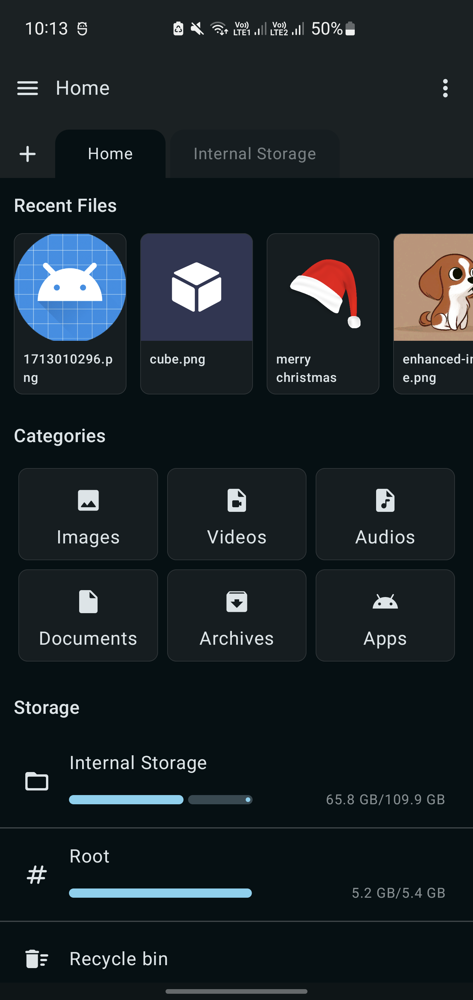
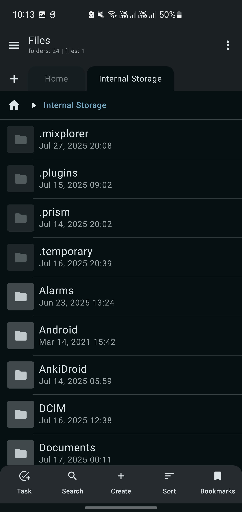
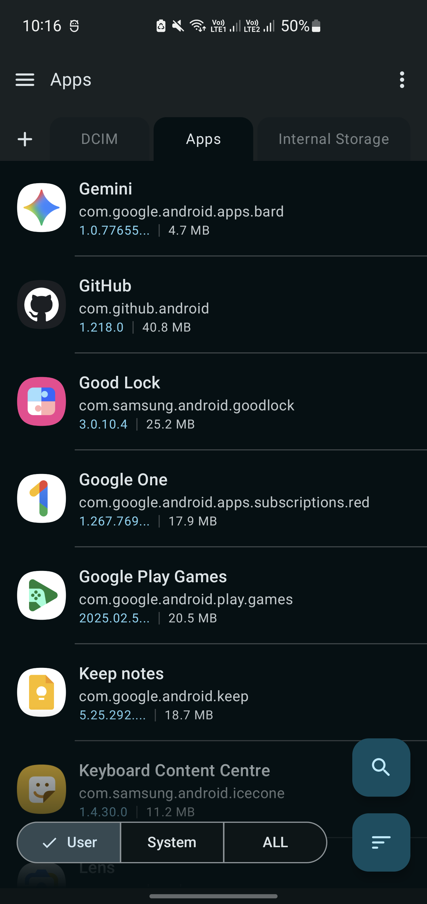
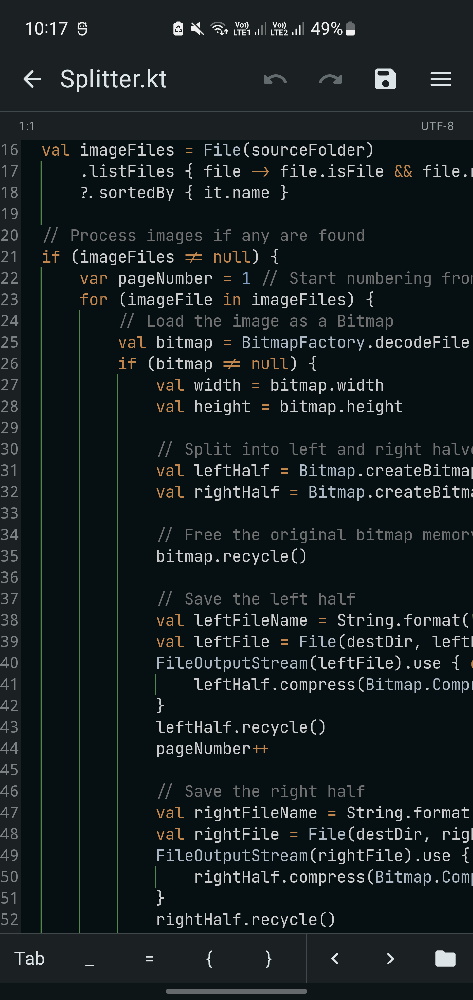
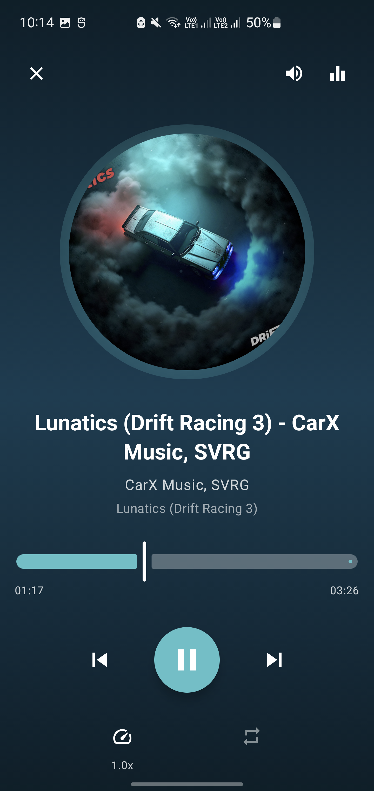
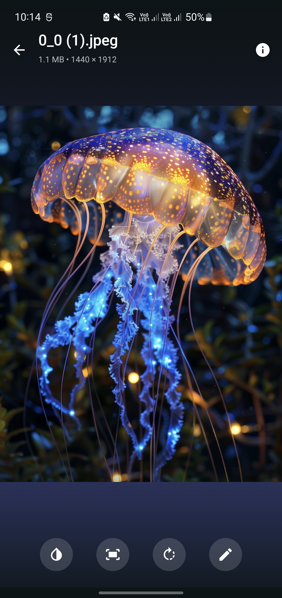
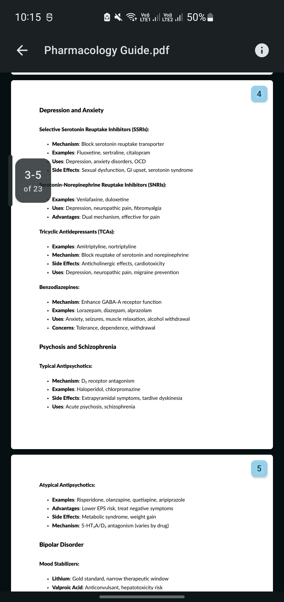

**Bahasa Indonesia** | [English](README.en.md)

> [!NOTE]
> Fork pribadi **IfanID** dari [Prism File Explorer](https://github.com/Raival-e/Prism-File-Explorer).

<div align="center">


# Rout Navi

<sub>Fork dari [Prism File Explorer](https://github.com/Raival-e/Prism-File-Explorer)</sub>

[](https://www.android.com/)
[](https://www.gnu.org/licenses/gpl-3.0)
[](https://github.com/IfanID/rout-navi/releases)
[](https://github.com/IfanID/rout-navi/releases)
[](https://github.com/IfanID/rout-navi/stargazers)
[](https://github.com/IfanID/rout-navi/network/members)

**Pengelola berkas Android yang modern, kaya fitur, dan ringan, dibangun sepenuhnya dengan Kotlin dan Jetpack Compose.**

*Menghadirkan pengalaman mengelola berkas yang mulus dengan antarmuka Material Design yang indah*

</div>

---

## 📱 Tangkapan Layar

<div align="center">
  
  
  
  
</div>

<div align="center">
  
  
  
</div>

---

## ✨ Fitur Utama

### 🆕 Fitur Tambahan (Fork IfanID)

Ringkasan fitur yang dibangun di fork ini, dari komit `068ad33` sampai komit terbaru.

#### 🎬 Subtitle dan Terjemahan

- Format subtitle teks didukung di editor: `srt`, `vtt`, `ass`, `ssa`, `sub`, `sbv`, `smi`, `sami`, `ttml`, `dfxp`, `lrc`, `scc`, dan `mpl2`.
- Grammar TextMate untuk `srt`, `vtt`, `ass`, dan `lrc`; `ttml`/`dfxp` memakai grammar XML yang sudah ada.
- `idx` dan `sup` ditandai sebagai subtitle bitmap yang tidak bisa diedit; `.sub` biner (VobSub) ditolak lewat deteksi header MPEG-PS.
- Ikon subtitle/closed caption dan fallback teks polos bila grammar gagal dimuat.
- Bahasa antarmuka: Inggris (default), Indonesia (`values-in`), Korea (`values-ko`), dan Mandarin (`values-zh`).

#### 🗜️ Arsip ZIP, 7Z, TAR, dan RAR

- Ekstrak arsip ke folder saat ini, ke dalam folder khusus arsip, atau ke path tujuan pilihan.
- Buka isi arsip langsung tanpa ekstrak (live ZIP, 7Z, TAR, RAR); format dideteksi dari magic bytes, bukan hanya ekstensi.
- Kompres ke ZIP, 7Z, atau TAR dengan pemilih format di samping kolom nama; format terakhir diingat.
- Dialog sandi untuk arsip terenkripsi dan penanganan konflik nama berkas saat ekstrak.

#### 🔐 Akses Root

- Layanan root berbasis libsu NIO dengan `FLAG_MOUNT_MASTER` agar isi `/data/data` terbaca lengkap.
- Daftar isi Root dinamis tanpa folder hardcode, lengkap dengan trail back dan urutan nama/folder.
- Metadata symlink dibaca lewat `lstat`; ikon link dan link rusak dibedakan.
- Berkas teks di area Root bisa dibuka di editor lewat pipe NIO.
- Fallback ke shell root jika layanan root gagal.

#### 🔖 Markah Folder Root

- Markah dan sematan folder Root dibangun ulang lewat `RootShell.holderFor()` supaya tetap dikenali sebagai folder.
- Markah ditulis dan dibaca langsung dari DataStore sehingga tidak hilang saat state sesi belum tersinkron.
- Opsi tambah/hapus markah tersedia juga saat berada di Root home.

#### 🔑 Dukungan Berkas Teks, Konfigurasi, dan Kunci SSH

- Berkas kunci publik dan sertifikat teks dibuka langsung di editor: `*.pub`, `*.pem`, `*.crt`, `*.cer`, `authorized_keys`, `known_hosts`, `ssh_config`, dan `sshd_config`.
- Script shell dikenali sebagai teks: `*.sh`, `*.zsh`, `*.bash`, `*.ksh`, `*.fish`, `*.csh`, `*.tcsh`, `*.ash`, `*.dash`, `*.shell`, `*.rc`, `*.zshrc`, `*.bashrc`, `*.profile`, riwayat shell, dan tema Zsh.
- Berkas konfigurasi teks: `*.properties`, `*.conf`, `*.cfg`, `*.ini`, `*.env`, termasuk `termux.properties`.
- Dotfile tanpa ekstensi seperti `.zshrc`, `.zshenv`, `.zprofile`, `.bashrc`, `.bash_profile`, `.profile`, `.vimrc`, `.nanorc`, `.gitconfig`, `.editorconfig`, `.tmux.conf`, dan `.screenrc` tetap terdeteksi sebagai teks.

#### ☑️ Properti Pilihan Multi-Item

- Properti Pilihan menampilkan **Lokasi** dan **Nama** untuk semua jenis berkas, folder, dan area Root.
- Pilihan dari beberapa folder ditampilkan berkelompok per folder.
- Long-press pada baris **Lokasi** menyalin path lengkap semua item.
- Long-press pada baris **Nama** menyalin nama item (bukan path), termasuk tiap nama di bawah folder saat pilihan berasal dari beberapa folder.

#### 🗂️ Pilihan Lintas Folder dan Tab

- Menu opsi menyediakan **Pilih file & folder** dan **Pilih file & folder lintas tab**.
- **Pilih file & folder**: pindah folder tidak menghapus pilihan, jadi berkas dari beberapa folder bisa diproses bersamaan.
- **Pilih file & folder lintas tab**: pilihan digabung antar tab, lalu tab baru dibuka di Penyimpanan internal untuk memilih dari lokasi lain.
- Strip di atas toolbar pilihan menampilkan objek dan aksinya: `Pilih file & folder` saat ON, `Jelajah file & folder` saat OFF, dengan varian `... lintas tab` bila mode lintas tab aktif.
- Badge **ON/OFF** di strip atas toolbar pilihan: `ON` berarti ketukan memilih, `OFF` berarti ketukan membuka berkas/folder tetapi pilihan tetap tersimpan.
- Long-press saat badge `OFF` langsung menyalakan mode seleksi.
- Jumlah pilihan tampil di kanan strip (mis. `12 dipilih · 2 folder`) dan langsung berubah setiap kali pilihan bertambah atau berkurang.
- Tombol **Batal** berbentuk pil dengan ikon `✕`, mengosongkan seluruh pilihan dan mematikan mode lintas folder/tab.

### 📦 Fitur Bawaan Prism

<details>
<summary><b>Lihat daftar fitur bawaan</b></summary>

### 🎨 **Antarmuka Modern**

- **UI Jetpack Compose**: Antarmuka deklaratif penuh dan responsif
- **Material Design 3**: Bahasa desain yang indah dan konsisten
- **Tema Terang/Gelap**: Dukungan pergantian tema otomatis
- **Animasi Mulus**: Transisi dan interaksi yang halus

### 📁 **Manajemen Berkas Menyeluruh**

- **Operasi Berkas Lengkap**: Buat, salin, pindah, ganti nama, dan hapus berkas maupun folder
- **Seleksi Lanjutan**: Multi-pilih dengan gestur yang intuitif
- **Potong/Salin/Tempel Cerdas**: Operasi papan klip dengan umpan balik visual
- **Operasi Massal**: Jalankan aksi pada banyak berkas sekaligus
- **Properti Berkas**: Informasi rinci tentang berkas dan direktori

### 🗂️ **Fitur Lanjutan**

- **Antarmuka Multi-Tab**: Kelola beberapa direktori sekaligus
- **Navigasi Cepat**: Navigasi breadcrumb dan pintasan akses cepat
- **Pencarian**: Temukan berkas dan folder dengan cepat
- **Opsi Pengurutan**: Urutkan berdasarkan nama, ukuran, tanggal, tipe, naik atau turun
- **Mode Tampilan**: Pilihan tampilan grid dan daftar
- **Akses Root**: Jelajahi direktori sistem terproteksi lewat layanan root

### 📺 **Penampil Media Bawaan**

- **Penampil Gambar**: Dukungan JPEG, PNG, GIF, WebP, dan lainnya
- **Pemutar Video**: Putar MP4, AVI, MKV, MOV, dan format lain
- **Pemutar Audio**: Dukungan pemutaran MP3, WAV, FLAC, OGG
- **Penampil PDF**: Lihat dokumen PDF secara langsung
- **Editor Teks**: Penyorotan sintaks untuk berkas kode
- **Dukungan Subtitle**: Lihat dan edit SRT, VTT, ASS, SSA, LRC, serta format subtitle lain dengan penyorotan sintaks

### 🗜️ **Manajemen Arsip**

- **Ekstrak Arsip**: Dukungan format ZIP, 7Z, TAR, dan RAR
- **Buat Arsip**: Kompres berkas dan folder ke ZIP, 7Z, atau TAR
- **Pratinjau Arsip**: Telusuri isi arsip tanpa ekstrak (live ZIP, 7Z, TAR, dan RAR)

### ⚡ **Performa dan Efisiensi**

- **Ringan**: Penggunaan sumber daya minimal dan startup cepat
- **Teroptimasi**: Performa mulus di perangkat kelas bawah
- **Operasi Latar Belakang**: Operasi berkas tanpa memblokir antarmuka
- **Hemat Memori**: Pengelolaan memori cerdas untuk direktori besar

</details>

---

## 📥 Pilihan Unduhan

| Platform            | Tautan                                                                                                                                       |
|---------------------|----------------------------------------------------------------------------------------------------------------------------------------------|
| **GitHub Releases** | [](https://github.com/IfanID/rout-navi/releases) |

### 📋 Persyaratan Sistem

- **Versi Android**: 12.0 (API 31) atau lebih baru
- **Izin**: Akses penyimpanan (`MANAGE_EXTERNAL_STORAGE` untuk mengelola seluruh berkas; dapat dicabut kapan saja)
- **Root (opsional)**: hanya diperlukan untuk menjelajah area sistem lewat layanan root
- **Arsitektur**: arm64-v8a, armeabi-v7a, x86, dan x86_64
- **Versi saat ini**: 0.0.1 (versionCode 1)

---

## 🛠️ Dibangun Dengan

| Teknologi                                                                                                                | Kegunaan             | Versi         |
|--------------------------------------------------------------------------------------------------------------------------|----------------------|---------------|
|                              | **Bahasa Pemrograman** | 2.4.21        |
|  | **Kerangka UI**      | BOM 2026.09.00 |
|                           | **Platform**         | SDK 37        |
|  | **Sistem Desain**    | Material 3    |
|                              | **Build Tool**       | 9.8.2         |
|                  | **Plugin Android**   | 9.5.0         |
|                               | **Runtime Build**    | 25 (LTS)      |

---

## 🔨 Membangun dari Sumber

### Prasyarat

- **JDK**: 25 (Gradle 9.8.2), minimum 17
- **Android SDK**: API level 37 + Build-Tools 37.0.0
- **Git**: Untuk mengkloning repositori

### Langkah Build

1. **Kloning repositori**:
   ```bash
   git clone https://github.com/IfanID/rout-navi.git
   cd rout-navi
   ```

2. **Build proyek** (Gradle wrapper otomatis mengunduh Gradle 9.8.2, tidak perlu memasang Gradle manual):
   ```bash
   ./gradlew assembleDebug     # APK debug
   ./gradlew assembleRelease   # APK release (perlu signing config)
   ```

3. **Temukan APK**:
    - Debug: `app/build/outputs/apk/debug/`
    - Release: `app/build/outputs/apk/release/`

### Catatan Opsional: Build di ARM64 (Termux)

Bagian ini **bukan syarat** — hanya berlaku kalau kamu membangun proyek di perangkat ARM64 (misalnya Termux dengan proot-distro). Build di Android Studio x86_64 tidak perlu setelan ini.

- Gunakan JDK 25, karena Gradle 9.x sudah mendukungnya; pastikan `JAVA_HOME` mengarah ke JDK tersebut.
- Arahkan `android.aapt2FromMavenOverride` ke aapt2 ARM64 dan set `android.enableResourceOptimizations=false` lewat `~/.gradle/gradle.properties` (bukan `gradle.properties` proyek), agar build CI x86_64 tetap berjalan.
- Jangan menyimpan path absolut mesin lokal di file proyek.

---

## 🤝 Kontribusi

1. **Fork** repositori ini
2. **Buat** branch fitur (`git checkout -b fitur/fitur-baru`)
3. **Commit** perubahan (`git commit -m 'Tambah fitur baru'`)
4. **Push** ke branch (`git push origin fitur/fitur-baru`)
5. **Buka** Pull Request

### 📝 **Panduan Pengembangan**

- Ikuti konvensi penulisan kode Kotlin
- Tulis pesan commit yang jelas

---

## 📊 Statistik Proyek


---

## 🙏 Sumber Asli

Proyek ini adalah fork dari **Prism File Explorer** karya [Raival-e](https://github.com/Raival-e).
Terima kasih kepada penulis asli atas basis kode dan lisensi GPLv3 yang memungkinkan fork ini.

- Repositori asli: https://github.com/Raival-e/Prism-File-Explorer

---

## 📄 Lisensi

Proyek ini dilisensikan di bawah **GNU General Public License v3.0**.

```
Prism File Explorer - A modern Android file manager
Copyright (C) 2024 Raival-e
Modifikasi fork © 2026 IfanID

This program is free software: you can redistribute it and/or modify
it under the terms of the GNU General Public License as published by
the Free Software Foundation, either version 3 of the License, or
(at your option) any later version.
```

Lihat berkas [LICENSE](LICENSE) untuk teks lisensi lengkap.

---

## 💬 Dukungan dan Komunitas

| Platform               | Kegunaan                          |
|------------------------|-----------------------------------|
| **GitHub Issues**      | Laporan bug, permintaan fitur     |
| **GitHub Discussions** | Dukungan komunitas, pertanyaan    |
| **Email**              | Pertanyaan pribadi                |

**⭐ Kalau proyek ini bermanfaat, pertimbangkan untuk memberi bintang!**

[](https://github.com/IfanID/rout-navi/stargazers)
